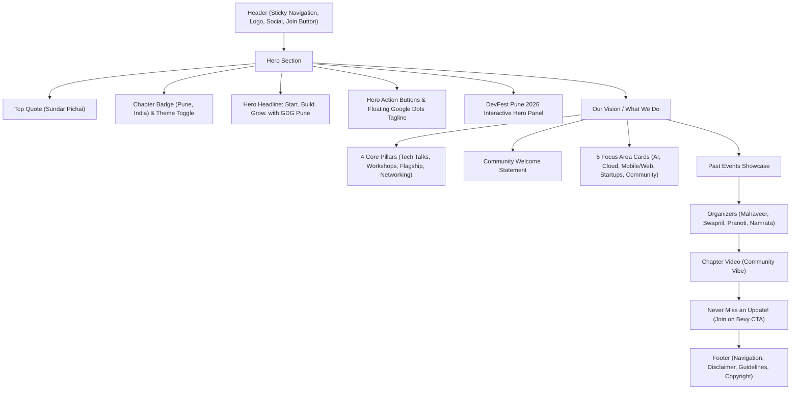

# Google Developer Group Pune (GDG Pune) — Official Website

The official web portal for **Google Developer Group Pune** ([gdgpune.in](https://gdgpune.in)) — built with **Next.js (App Router)**, **TypeScript**, and **Tailwind CSS v4**.

---

## 🗺️ Complete Website Map & Architecture

### Page Structure & Sections



### File & Directory Map

```text
GDGPune_Website/
├── app/                          # Next.js App Router core
│   ├── globals.css               # Design tokens, color palette, animations (@keyframes dot-float)
│   ├── layout.tsx                # Root layout with Google Sans Flex fonts, SEO metadata, JSON-LD schema
│   ├── page.tsx                  # Home page assembling all visual sections
│   ├── opengraph-image.tsx       # Dynamic edge OG card generator
│   ├── robots.ts                 # Search engine crawler permissions
│   └── sitemap.ts                # XML Sitemap generator
├── components/                   # Modular UI components
│   ├── SiteHeader.tsx            # Sticky navigation bar with mobile drawer
│   ├── Hero.tsx                  # Main hero section with quote and action links
│   ├── DevFestHeroPanel.tsx      # DevFest Pune 2026 showcase card
│   ├── DevFestBraceField.tsx     # Animated brace particle field
│   ├── Focus.tsx                 # "Our Vision" section with 4 pillars & 5 focus areas
│   ├── Events.tsx                # Flagship gatherings & past event cards
│   ├── Organizers.tsx            # Single-line desktop organizer grid (4 columns)
│   ├── ChapterVideo.tsx          # Embedded community vibe YouTube video
│   ├── JoinCta.tsx               # "Never miss an update!" Bevy CTA banner
│   ├── SiteFooter.tsx            # Chapter & Program links, disclaimer, guidelines, copyright
│   ├── SectionHeading.tsx        # Consistent mono-eyebrow section headers
│   ├── ButtonLink.tsx            # Accessible primary and outline button links
│   ├── SmartLink.tsx             # Intelligent routing (internal vs external links)
│   └── SocialLinks.tsx           # LinkedIn, X, Instagram, YouTube social buttons
├── data/
│   └── site.ts                   # Central content hub: URLs, focus tags, events, organizers
├── public/                       # Static images, SVG logos, favicons
│   ├── gdg-pune-logo.svg         # Primary GDG Pune logo
│   ├── gdg-logo.svg              # Google Developer Groups symbol
│   └── gdg-cloud-pune-logo.png   # Chapter branding asset
├── next.config.ts                # Next.js configuration and image domains (Cloudinary)
├── package.json                  # Dependencies and build scripts
└── tsconfig.json                 # TypeScript strict compiler config
```

### Content Hub (`data/site.ts`)

All content that updates regularly is isolated in [`data/site.ts`](data/site.ts):
- **Chapter Links**: Bevy community URL, DevFest site, GDG program links.
- **Focus Areas**: AI/Agentic AI, Cloud, Mobile & Web, Startups, Community.
- **Past Events**: DevFest Pune, Cloud Community Days, Build with AI, Google I/O Extended.
- **Organizers**: Names, titles, company affiliations, profile avatars, Bevy & LinkedIn links.

---

## 💻 Local Development & Cloning

### 1. Prerequisites
- **Node.js**: v20+ or v22 LTS (`node -v`)
- **Package Manager**: `pnpm` (recommended) or `npm`

### 2. Clone the Repository
```bash
git clone https://github.com/Google-Developers-Groups-Pune/GDGPune_Website.git
cd GDGPune_Website
```

### 3. Install Dependencies
```bash
# Using pnpm
pnpm install

# Or using npm
npm install
```

### 4. Run Development Server
```bash
pnpm dev
# or npm run dev
```
Open **[http://localhost:3000](http://localhost:3000)** in your browser.

### 5. Build for Production
```bash
pnpm build
pnpm start
```

---

## 🚀 How to Go Live (`gdgpune.in`)

### Step 1: Deploy to Vercel (Recommended for Next.js)
1. Go to [vercel.com](https://vercel.com) and log in with your GitHub account.
2. Click **"Add New..."** → **"Project"**.
3. Import the `Google-Developers-Groups-Pune/GDGPune_Website` repository.
4. Keep the default settings (Framework Preset: **Next.js**, Root Directory: `./`).
5. (Optional) Set Environment Variable `NEXT_PUBLIC_GA_ID` if you use Google Analytics.
6. Click **Deploy**. Vercel will build and assign a deployment URL (e.g. `gdgpune-website.vercel.app`).

### Step 2: Configure Custom Domain (`gdgpune.in`) on Vercel
1. In your Vercel Project Dashboard, navigate to **Settings** → **Domains**.
2. Add:
   - `gdgpune.in`
   - `www.gdgpune.in` (set to redirect to `gdgpune.in` or vice versa).
3. Vercel will display the DNS records needed:
   - **A Record**: `76.76.21.21` (or CNAME `cname.vercel-dns.com`).

### Step 3: Configure Cloudflare DNS (Domain from GoDaddy)
Since your domain nameservers are already pointed to Cloudflare:
1. Log into your [Cloudflare Dashboard](https://dash.cloudflare.com/) and select `gdgpune.in`.
2. Go to **DNS** → **Records**:
   - **Type**: `A` | **Name**: `@` | **IPv4 address**: `76.76.21.21` | **Proxy status**: `DNS only` (Grey cloud recommended initially for SSL verification, can be proxied afterwards).
   - **Type**: `CNAME` | **Name**: `www` | **Target**: `cname.vercel-dns.com` | **Proxy status**: `DNS only`.
3. In Cloudflare, go to **SSL/TLS** → **Overview**:
   - Set encryption mode to **Full** or **Full (strict)**.
   *(⚠️ Do not use "Flexible", or it will cause an infinite HTTP 301 redirect loop with Vercel).*
4. Within 2-10 minutes, Vercel will issue a valid SSL certificate and your website will be live at **https://gdgpune.in**!

---

## 🛑 How to Close / Decommission the Website

If at any point the team needs to take down, pause, or permanently close this website, follow these steps:

### Option A: Redirect Traffic to Bevy Chapter Page (Recommended)
Instead of taking down the domain and showing an error, gracefully redirect all visitors to the official Google community page:
1. Open [Cloudflare Dashboard](https://dash.cloudflare.com/) → `gdgpune.in`.
2. Go to **Rules** → **Redirect Rules** (or Page Rules).
3. Create a rule:
   - **When incoming requests match**: `Hostname equals gdgpune.in` OR `Hostname equals www.gdgpune.in`
   - **Type**: Dynamic or Static Redirect (301 Permanent)
   - **Target URL**: `https://gdg.community.dev/gdg-pune/`
4. This preserves SEO value and guides users to the active chapter page.

### Option B: Display a Maintenance / Retirement Notice
1. Edit `app/page.tsx` or deploy a simple static maintenance page.
2. Display a retirement message pointing members to GDG Pune's social media and Bevy community.

### Option C: Permanently Take Down the Website
1. **Unlink Vercel Project**:
   - In Vercel Project Dashboard → **Settings** → **Advanced** → **Delete Project**.
2. **Remove DNS Records**:
   - In Cloudflare DNS, delete the `A` and `CNAME` records pointing to Vercel.
3. **Archive GitHub Repository**:
   - On GitHub, go to `GDGPune_Website` → **Settings** → **Danger Zone** → **Archive this repository** (or make private).

---

## 📜 Community & Conduct

- All attendees, speakers, sponsors, and organizers follow the [Google Developer Community Guidelines](https://www.google.com/events/policy/anti-harassmentpolicy.html).
- GDG Pune is an independent group; activities and opinions expressed are not linked to Google the corporation. Learn more at [developers.google.com/community/gdg](https://developers.google.com/community/gdg).

© 2026 Google Developer Group Pune.
